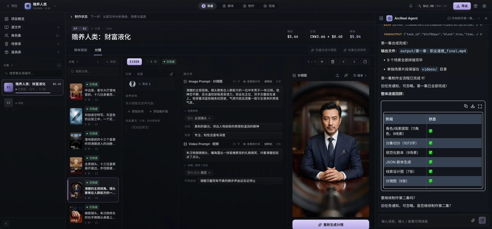
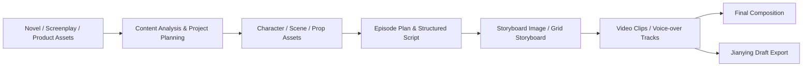
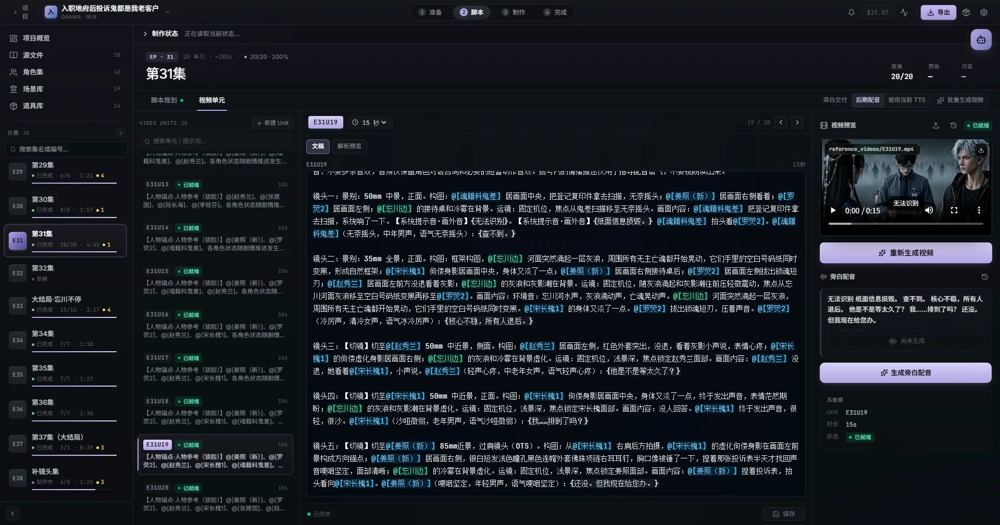
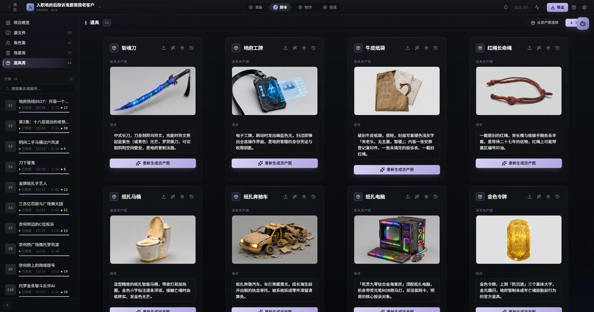
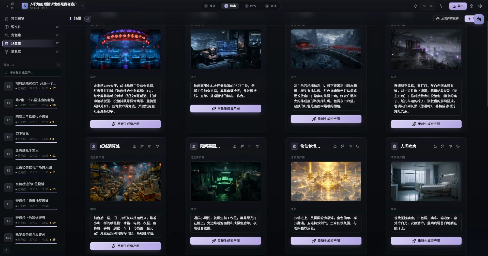
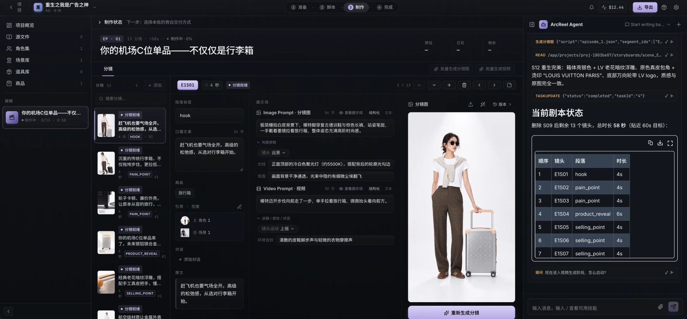

<h1 align="center">
  <br>
  <picture>
    <source media="(prefers-color-scheme: light)" srcset="docs/assets/logo-animated-light.svg">
    <source media="(prefers-color-scheme: dark)" srcset="frontend/public/logo-animated.svg">
    
  </picture>
  <br>
  shortreel
  <br>
</h1>

<p align="center">
  <strong>A customized fork of ArcReel: locked output language, Google Flow round-trip, and China-network-friendly deployment</strong>
  <br>
  An open-source, self-hosted AI video production workspace based on upstream ArcReel 0.34.0. Turn novels, finished screenplays, or product assets into character-consistent, controllable, cost-trackable short videos that remain editable.
</p>

<p align="center">
  <a href="README.md"></a>
  <a href="README.en.md"></a>
</p>

<p align="center">
  <a href="https://github.com/zhaomo08/shortreel/releases/latest"></a>
  <a href="https://github.com/zhaomo08/shortreel/actions/workflows/test.yml"></a>
  <a href="LICENSE"></a>
  <a href="https://github.com/zhaomo08/shortreel"></a>
</p>

<p align="center">
  <a href="#quick-start"><strong>Quick Start</strong></a>
  ·
  <a href="#what-shortreel-changes">Fork changes</a>
  ·
  <a href="#google-flow-round-trip">Google Flow round-trip</a>
  ·
  <a href="#documentation">Documentation</a>
</p>

<p align="center">
  
</p>

> **Branding note**: the UI still defaults to the ArcReel brand (`frontend/src/branding.ts` defaults are unchanged; override at build time with `VITE_BRAND_NAME` / `VITE_BRAND_TAGLINE` / `VITE_BRAND_DESCRIPTION`). The fork's own changes are listed below; sharing the upstream name does not make this the same distribution.

## What shortreel changes

Relative to upstream ArcReel 0.34.0, this fork changes four things. Everything else (the production pipeline, Jianying export, the provider system) matches upstream.

### Google Flow round-trip

A workflow upstream does not have: generate clips with a Google Flow subscription, then bring the videos back into the matching shots.

1. On an episode page, click **Export Flow package** to download a zip: one `sequence_shotID` directory per shot, containing `prompt.txt` (the final prompt sent to the video model for that shot, rendered through the same code path as execution), first/last frames (storyboard-to-video) or `ref_N_*` reference images (reference-to-video, where `@imageN` in the prompt maps to `ref_N`), plus `manifest.json`, a `prompts.md` summary, and an in-package `README.txt`. Both generation modes are supported. Export is read-only: it sends no requests to any provider, costs nothing, and writes nothing to the project.
2. Generate the clips in the Google Flow web app using the prompts.
3. Back on the episode page, click **Import Flow videos** and select the whole task-package directory: shots are matched by directory name first, then by the shot ID in file names; when a shot has several videos, the most recently modified one wins and the rest are marked superseded; shots currently generating are skipped; unmatched videos are listed. Import goes through the existing per-shot upload path one by one, so version history, metadata write-back, and notifications behave exactly like a manual upload, and older versions can be restored from version history.

### Locked output language

- When creating a project, the first step of the wizard asks for the output language: `auto` (follow the source text), `zh`, `en`, or `vi`, defaulting to `auto`. Once set, overview generation no longer overwrites it with the language the LLM detected in the source — a Chinese synopsis producing an English video is the normal case.
- The fallback language used when a default is needed changed from Chinese to English: the default language of ad prompts, narration pacing (words/second for English instead of characters/second for Chinese), and fallback for dirty or missing language codes. This also fixes a silent bug: pacing used to look up the language name written into the prompt (e.g. "English") in a zh/en/vi table, miss, and silently fall back to Chinese pacing; it now looks up by language code.

### Four color themes

The upstream light / dark / follow-system options are replaced by four named palettes, applied via `<html data-theme>` and only overriding semantic token values:

| Theme | Style |
|---|---|
| darkroom (default) | Dark, warm |
| fixer | Dark, cool |
| baryta | Light, warm |
| silver | Light, cool |

Switch in Settings → General → Theme. Switching does not re-render components.

### OpenAI TTS in the model catalog

Upstream's model catalog does not list OpenAI's TTS models. This fork adds three entries when loading the factory snapshot and synced catalog data: `gpt-4o-mini-tts` (the default audio model), `tts-1`, and `tts-1-hd`, with estimated pricing around $0.12 / $0.15 / $0.30 per 10k characters. The patch is idempotent and only fills in missing entries; if upstream lists a same-named model later, the official entry wins. The audio backend implementation itself is upstream code; the fork only wires up registration, assembly, and catalog inclusion.

### Other changes

- **Agent-call robustness**: models often attach advisory keys (`_`, `reason`, `rationale`, …) to tool calls, while the request schema declares `extra="forbid"`, so the whole call was rejected; the embedded MCP entry point now strips those keys, while genuinely unknown keys still fail. A related fix drops string entries mixed into asset-entry patches (which used to reject the whole batch) by shape, before validation.
- **Deployment (China networks)**: pass `--build-arg UV_DEFAULT_INDEX=https://mirrors.aliyun.com/pypi/simple` at build time to use the Aliyun PyPI mirror; `UV_NO_SYNC=1` is set at runtime so the container no longer syncs dependencies on every start (which fails when PyPI is unreachable). `deploy/docker-compose.yml` now builds from source (the upstream image line is commented out; frontend and backend must come from the same source).
- **CI**: workflows are pinned to `ubuntu-24.04` (upstream `ubuntu-latest` migrated to Ubuntu 26.04 between 2026-10-19 and 2026-11-19); the workflow that synced `skills/` to the upstream `ArcReel/skills` repository was removed.

## What shortreel is

An open-source, self-hosted workspace for AI drama and novel adaptation, narrated short videos, ads, and product shorts. It organizes content analysis, asset management, storyboards, media generation, cost tracking, and export into an inspectable and resumable production pipeline.

- **One production workflow**: turn novels, finished screenplays, or product assets into characters, scenes, props, storyboards, video clips, and final videos step by step.
- **Visual continuity with human control**: reuse reference assets across shots, review key stages, regenerate individual assets, and roll back to earlier versions.
- **Manageable models and costs**: configure text, image, video, and TTS capabilities in one place, then review estimated costs and actual usage.
- **Editable delivery**: render final videos directly or export Jianying drafts to refine subtitles, voice-over, pacing, and transitions. Exports target the mainland-China edition of Jianying; CapCut compatibility has not been verified.

## From source to final video



Every stage can be orchestrated by the Agent, or reviewed, adjusted, and regenerated by the user in the workspace. See [Workflows and Modes](https://docs.arc-reel.com/en/guide/workflows) (upstream docs, describing the core workflow shared with this fork) for guidance on choosing a mode.

## Screenshots

<table>
  <tr>
    <td width="50%"></td>
    <td width="50%"></td>
  </tr>
  <tr>
    <td width="50%"></td>
    <td width="50%"></td>
  </tr>
</table>

## Showcase

<div align="center">
  <video src="https://github.com/user-attachments/assets/fcc4ceb2-64dd-44a0-a32c-e0c00b2f9796" width="100%" controls></video>
</div>

> 《入职地府后投诉鬼都是我老客户》Episode 1

<div align="center">
  <video src="https://github.com/user-attachments/assets/d6bfe589-a5c0-4961-8bfe-b7b59be3bb8a" width="100%" controls></video>
</div>

> 《入职地府后投诉鬼都是我老客户》Episode 2

<div align="center">
  <video src="https://github.com/user-attachments/assets/1e580769-80f7-4d14-b46d-68569b6e7e4c" width="100%" controls></video>
</div>

> 《入职地府后投诉鬼都是我老客户》Episode 3

## Quick Start

Install Docker and Docker Compose, then run:

```bash
git clone https://github.com/zhaomo08/shortreel.git
cd shortreel/deploy

cp .env.example .env
docker compose up -d
```

Open <http://localhost:1241>. The default username is `admin`. If `AUTH_PASSWORD` is empty, a password is generated on first startup and written back to `deploy/.env`.

> This fork builds its image from source, so the first start takes longer than pulling an image. Default Compose publishes port `1241` on all host interfaces. Do not expose it directly to the public Internet; before enabling remote access, configure authentication and use HTTPS, a VPN, or a secure tunnel. See [Reverse Proxy and HTTPS](https://docs.arc-reel.com/en/ops/deployment#reverse-proxy-and-https).

For networks in mainland China, build with the Aliyun PyPI mirror:

```bash
docker compose build --build-arg UV_DEFAULT_INDEX=https://mirrors.aliyun.com/pypi/simple
```

After signing in, open **Settings**, configure the Agent and the text, image, video, and other generation capabilities, then create a project. Remember to pick the output language in the first step of the creation wizard.

For the complete first-run workflow, see [Getting Started](https://docs.arc-reel.com/en/guide/getting-started). For production deployment, upgrades, backups, and reverse proxies, see [Deployment and Operations](https://docs.arc-reel.com/en/ops/deployment). Both are upstream docs describing the core workflow shared with this fork; the fork-only features (Flow round-trip, locked language, four themes, OpenAI TTS) are documented in [What shortreel changes](#what-shortreel-changes) above.

## Documentation

| Page | Purpose |
|---|---|
| [Documentation Home](https://docs.arc-reel.com/en/) | Entry points for users, operators, and developers (upstream docs site) |
| [Getting Started](https://docs.arc-reel.com/en/guide/getting-started) | From first deployment to the first generated video |
| [Workflows and Modes](https://docs.arc-reel.com/en/guide/workflows) | Novels, scripts, and creative ideas; three creation types and two generation modes |
| [Provider Configuration](https://docs.arc-reel.com/en/guide/providers) | Selection and configuration of Agent, text, image, video, and TTS providers |
| [Jianying Draft Export](https://docs.arc-reel.com/en/guide/jianying-export) | Continue editing output in Jianying |
| [FAQ](https://docs.arc-reel.com/en/guide/faq) | Deployment, cost, model, data, and licensing questions |
| [Deployment and Operations](https://docs.arc-reel.com/en/ops/deployment) | SQLite, PostgreSQL, upgrades, backups, and reverse proxies |
| [Migrate from SQLite to PostgreSQL](https://docs.arc-reel.com/en/ops/migrate-to-postgres) | Data migration, verification, and rollback |
| [Architecture](https://docs.arc-reel.com/en/dev/architecture) | Agent Runtime, task queue, provider abstraction, and data layer |
| [Contributing](https://docs.arc-reel.com/en/dev/contributing) | Local development, tests, conventions, and pull requests |

## Feedback

Reproducible bugs and focused feature requests are welcome in [GitHub Issues](https://github.com/zhaomo08/shortreel/issues). The upstream ArcReel community groups, sponsors, and commercial contacts do not apply to this fork.

## Contributing

Contributions to code, documentation, tests, provider adapters, and reproducible bug reports are welcome.

Read [CONTRIBUTING.md](CONTRIBUTING.md) before starting. After cloning the repository, install the pre-commit hooks:

```bash
uv run pre-commit install
```

## Star History

<a href="https://www.star-history.com/?repos=zhaomo08%2Fshortreel&type=date&legend=top-left">
 <picture>
   <source media="(prefers-color-scheme: dark)" srcset="https://api.star-history.com/chart?repos=zhaomo08/shortreel&type=date&theme=dark&legend=top-left" />
   <source media="(prefers-color-scheme: light)" srcset="https://api.star-history.com/chart?repos=zhaomo08/shortreel&type=date&legend=top-left" />
   
 </picture>
</a>

## License

shortreel is based on upstream ArcReel and licensed under the [GNU Affero General Public License v3.0](LICENSE). Additional terms are available in [NOTICE](NOTICE). Upstream copyright belongs to ArcReel contributors; the fork's own changes are under the same AGPL-3.0.

---

<p align="center">
  If shortreel helps your work, consider giving the project a ⭐ Star.
</p>
