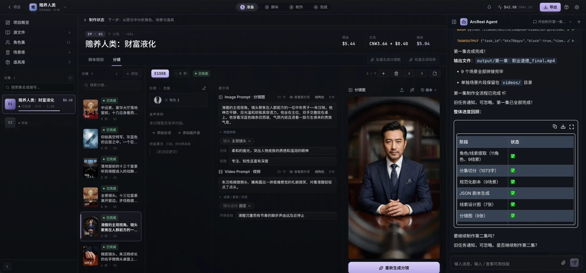
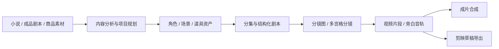
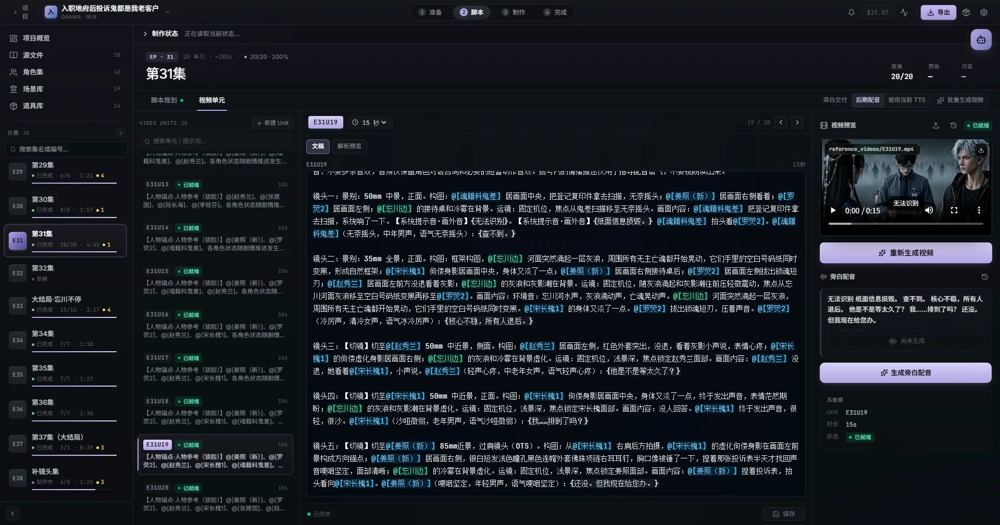
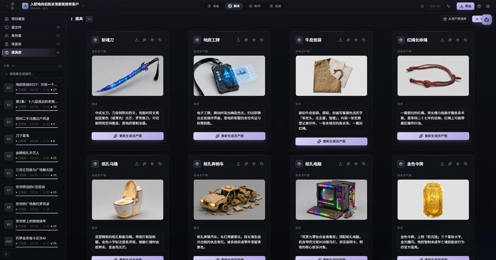
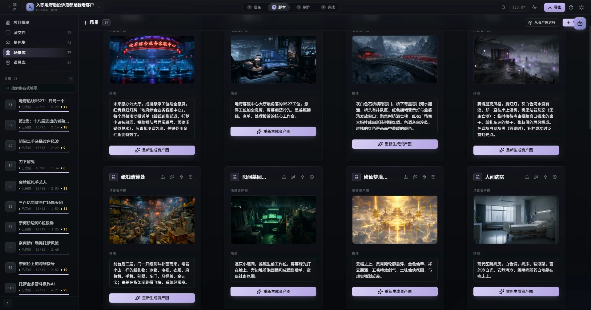
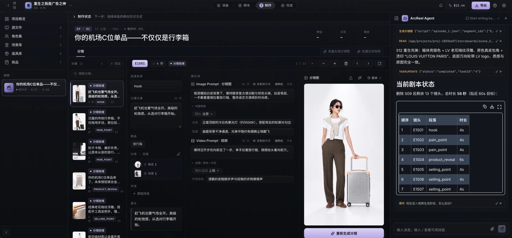

<h1 align="center">
  <br>
  <picture>
    <source media="(prefers-color-scheme: light)" srcset="docs/assets/logo-animated-light.svg">
    <source media="(prefers-color-scheme: dark)" srcset="frontend/public/logo-animated.svg">
    
  </picture>
  <br>
  shortreel
  <br>
</h1>

<p align="center">
  <strong>ArcReel 的定制版：中英双语成片、Google Flow 往返、大陆网络开箱即用</strong>
  <br>
  基于上游 ArcReel 0.34.0 的自托管 AI 视频生产工作台：把小说、成品剧本或商品素材转化为角色一致、过程可控、成本可追踪、可继续编辑的短视频。
</p>

<p align="center">
  <a href="README.md"></a>
  <a href="README.en.md"></a>
</p>

<p align="center">
  <a href="https://github.com/zhaomo08/shortreel/releases/latest"></a>
  <a href="https://github.com/zhaomo08/shortreel/actions/workflows/test.yml"></a>
  <a href="LICENSE"></a>
  <a href="https://github.com/zhaomo08/shortreel"></a>
</p>

<p align="center">
  <a href="#快速开始"><strong>快速开始</strong></a>
  ·
  <a href="#shortreel-改了什么">定制改动</a>
  ·
  <a href="#google-flow-任务包往返">Google Flow 往返</a>
  ·
  <a href="#文档">文档</a>
</p>

<p align="center">
  
</p>

> **品牌说明**：界面默认品牌仍为 ArcReel（`frontend/src/branding.ts` 默认值未改，可用 `VITE_BRAND_NAME` / `VITE_BRAND_TAGLINE` / `VITE_BRAND_DESCRIPTION` 在构建期覆盖）。本仓库的定制内容见下文，与上游同名不代表同一发行。

## shortreel 改了什么

相对上游 ArcReel 0.34.0，本 fork 的改动集中在四件事上；其余能力（生产链路、剪映导出、供应商体系）与上游一致。

### Google Flow 任务包往返

上游没有的工作流：用 Google Flow 的订阅额度出片，再把视频导回对应镜头。

1. 在剧集页点**导出 Flow 任务包**，得到一个 zip：每个镜头一个 `序号_镜头ID` 目录，内含 `prompt.txt`（该镜头送视频模型的最终提示词，与执行路径同一渲染出口）、首帧/尾帧（分镜图生视频）或 `ref_N_*` 参考图（参考生视频，提示词里的 `@图片N` 对应 `ref_N`），另附 `manifest.json`、`prompts.md` 汇总与包内 `README.txt`。两种生成模式都支持；导出只读，不向供应商发请求、不产生费用、不写项目。
2. 在 Google Flow 网页里按提示词出片。
3. 回到剧集页点**导入 Flow 视频**，选择整个任务包目录：按目录名优先、文件名里的镜头 ID 其次匹配镜头；同一镜头多个视频取最后修改的那个，其余记为 superseded；正在生成的镜头跳过；对不上的视频会列出来。导入逐个走既有单镜头上传接口，版本记录、元数据回写与推送与手动上传一致，旧版本可在版本记录里恢复。

### 成片语言可锁定

- 新建项目时在向导第一步选成片语言：`auto`（跟随源文）、`zh`、`en`、`vi`，默认 `auto`。选定后概述生成不再用 LLM 识别出的源文语言覆盖它——中文梗概做英文片成为常态。
- 需要默认值时的回退语言由中文改为英文：广告提示词默认语言、口播语速折算默认按英文（词/秒）而非中文（字/秒）、脏数据或缺失语言码的回退。另修了一个静默错误：此前语速表拿写进提示词的语言名（如 "English"）查 zh/en/vi 的表会查不中、静默回退中文语速，现改走语言码查表。

### 四套配色

上游的浅色 / 深色 / 跟随系统三档已替换为四套命名配色，挂在 `<html data-theme>` 上，只覆盖语义 token 取值：

| 配色 | 样式 |
|---|---|
| 暗房 darkroom（默认） | 深色暖调 |
| 定影 fixer | 深色冷调 |
| 相纸 baryta | 浅色暖调 |
| 银盐 silver | 浅色冷调 |

切换入口在设置页「通用」→「配色」下拉，切换不触发组件重渲染。

### OpenAI TTS 进入模型目录

上游模型目录没有收录 OpenAI 的 TTS 模型，本 fork 在出厂快照与官方同步数据装入时补进三条：`gpt-4o-mini-tts`（默认音频模型）、`tts-1`、`tts-1-hd`，附估算定价约 $0.12 / $0.15 / $0.30 每万字符。补丁是幂等的、缺了才补，官方日后收录同名模型时以官方为准。音频后端实现本身是上游已有的代码，补的是注册、装配与目录收录三处接线。

### 其他改动

- **Agent 调用鲁棒性**：模型常在工具调用上附 `_` / `reason` / `rationale` 等说明键，而请求模型声明了 `extra="forbid"`，整个调用会被拒；现入口会剥掉这类说明键，未知键仍照常报错。另修了模型往资产条目里混进字符串说明导致整批资产被拒的问题，按值的形状剔掉字符串条目。
- **部署（大陆网络）**：构建期可传 `--build-arg UV_DEFAULT_INDEX=https://mirrors.aliyun.com/pypi/simple` 走阿里 PyPI 镜像；运行时设 `UV_NO_SYNC=1`，不再同步依赖（否则每次启动都会联网安装依赖，PyPI 连不上时容器起不来）。`deploy/docker-compose.yml` 已改为从源码构建（上游镜像行已注释掉，前后端须同源）。
- **CI**：工作流固定在 `ubuntu-24.04`（上游 `ubuntu-latest` 在 2026-10-19 至 2026-11-19 迁移到 Ubuntu 26.04）；删除了向上游 `ArcReel/skills` 仓库同步 `skills/` 的工作流。

## shortreel 是什么

面向 AI 漫剧与小说改编、旁白/解说短视频、广告与带货短片的开源自托管工作台。它把内容分析、资产管理、分镜、媒体生成、费用追踪和导出组织成一条可审核、可中断恢复的生产流水线。

- **统一生产链路**：小说、成品剧本或商品素材都能逐步转化为角色、场景、道具、分镜、视频片段和最终成片。
- **视觉一致、人工可控**：跨分镜复用资产图等参考图，关键阶段可确认，单个素材可重做，历史版本可回滚。
- **模型与成本可管理**：统一配置文本、图像、视频和 TTS 能力，并在生成前后查看费用与实际用量。
- **交付可继续编辑**：既可直接合成视频，也可导出剪映草稿继续调整字幕、配音、节奏和转场。导出面向中国大陆版剪映，与 CapCut 的兼容性尚未验证。

## 从输入到成片



每个阶段都可以由 Agent（智能体）编排，也可以由用户在工作台中审核、调整或重新生成。详细模式选择见 [创作流程与模式](https://docs.arc-reel.com/guide/workflows)（上游文档，描述与本 fork 共享的核心流程）。

## 界面一览

<table>
  <tr>
    <td width="50%"></td>
    <td width="50%"></td>
  </tr>
  <tr>
    <td width="50%"></td>
    <td width="50%"></td>
  </tr>
</table>

## 案例

<div align="center">
  <video src="https://github.com/user-attachments/assets/fcc4ceb2-64dd-44a0-a32c-e0c00b2f9796" width="100%" controls></video>
</div>

> 《入职地府后投诉鬼都是我老客户》第 1 集

<div align="center">
  <video src="https://github.com/user-attachments/assets/d6bfe589-a5c0-4961-8bfe-b7b59be3bb8a" width="100%" controls></video>
</div>

> 《入职地府后投诉鬼都是我老客户》第 2 集

<div align="center">
  <video src="https://github.com/user-attachments/assets/1e580769-80f7-4d14-b46d-68569b6e7e4c" width="100%" controls></video>
</div>

> 《入职地府后投诉鬼都是我老客户》第 3 集

## 快速开始

准备好 Docker 和 Docker Compose，然后运行：

```bash
git clone https://github.com/zhaomo08/shortreel.git
cd shortreel/deploy

cp .env.example .env
docker compose up -d
```

访问 <http://localhost:1241>。默认用户名为 `admin`；`AUTH_PASSWORD` 留空时，首次启动会自动生成密码并回写到 `deploy/.env`。

> 本 fork 从源码构建镜像，首次启动需要构建前后端，比直接拉镜像慢。默认 Compose 会将 `1241` 端口发布到宿主机所有网络接口。请勿将服务直接暴露到公网；远程访问前请配置认证，并使用 HTTPS、VPN 或安全隧道，详见 [反向代理与 HTTPS](https://docs.arc-reel.com/ops/deployment#reverse-proxy-and-https)。

大陆网络构建时可用阿里 PyPI 镜像：

```bash
docker compose build --build-arg UV_DEFAULT_INDEX=https://mirrors.aliyun.com/pypi/simple
```

登录后进入 **设置** 页面，配置 Agent 以及文本、图像、视频等生成能力，再创建项目开始制作。新建项目时记得在向导第一步选成片语言。

完整的首次使用流程见 [完整入门教程](https://docs.arc-reel.com/guide/getting-started)；生产部署、升级、备份和反向代理见 [部署与运维](https://docs.arc-reel.com/ops/deployment)。以上两处是上游文档，描述与本 fork 共享的核心流程；本 fork 独有的功能（Flow 往返、语言锁定、四套配色、OpenAI TTS）见本 README 的 [shortreel 改了什么](#shortreel-改了什么)。

## 文档

| 页面 | 内容 |
|---|---|
| [文档首页](https://docs.arc-reel.com/) | 按使用者、运维者和开发者进入文档（上游文档站） |
| [完整入门教程](https://docs.arc-reel.com/guide/getting-started) | 从首次部署到生成第一条视频 |
| [创作流程与模式](https://docs.arc-reel.com/guide/workflows) | 小说、剧本与创作构想，三种创作类型及两种生成模式 |
| [供应商与模型配置](https://docs.arc-reel.com/guide/providers) | Agent、文本、图像、视频、TTS 供应商的选择和配置 |
| [剪映草稿导出](https://docs.arc-reel.com/guide/jianying-export) | 将生成结果交给剪映继续编辑 |
| [常见问题](https://docs.arc-reel.com/guide/faq) | 部署、费用、模型、数据和许可证问题 |
| [部署与运维](https://docs.arc-reel.com/ops/deployment) | SQLite、PostgreSQL、升级、备份和反向代理 |
| [从 SQLite 迁移到 PostgreSQL](https://docs.arc-reel.com/ops/migrate-to-postgres) | 数据迁移、验证与回滚流程 |
| [架构说明](https://docs.arc-reel.com/dev/architecture) | Agent Runtime、任务队列、供应商抽象和数据层 |
| [贡献指南](https://docs.arc-reel.com/dev/contributing) | 本地开发、测试、代码规范和 PR 流程 |

## 反馈

遇到可以复现的 Bug 或明确的功能需求，直接提交 [GitHub Issue](https://github.com/zhaomo08/shortreel/issues)。上游 ArcReel 的交流群、赞助商与商务联系方式不适用于本 fork。

## 贡献

欢迎贡献代码、文档、测试、供应商适配和问题复现。

开始开发前请阅读 [CONTRIBUTING.md](CONTRIBUTING.md)。本地克隆后建议立即安装项目的 pre-commit 钩子：

```bash
uv run pre-commit install
```

## Star History

<a href="https://www.star-history.com/?repos=zhaomo08%2Fshortreel&type=date&legend=top-left">
 <picture>
   <source media="(prefers-color-scheme: dark)" srcset="https://api.star-history.com/chart?repos=zhaomo08/shortreel&type=date&theme=dark&legend=top-left" />
   <source media="(prefers-color-scheme: light)" srcset="https://api.star-history.com/chart?repos=zhaomo08/shortreel&type=date&legend=top-left" />
   
 </picture>
</a>

## 许可证

shortreel 基于上游 ArcReel，采用 [GNU Affero General Public License v3.0](LICENSE)，附加条款见 [NOTICE](NOTICE)。上游版权归 ArcReel contributors 所有；本 fork 的改动部分同样遵循 AGPL-3.0。

---

<p align="center">
  如果 shortreel 对你有帮助，欢迎点亮一个 ⭐ Star。
</p>
